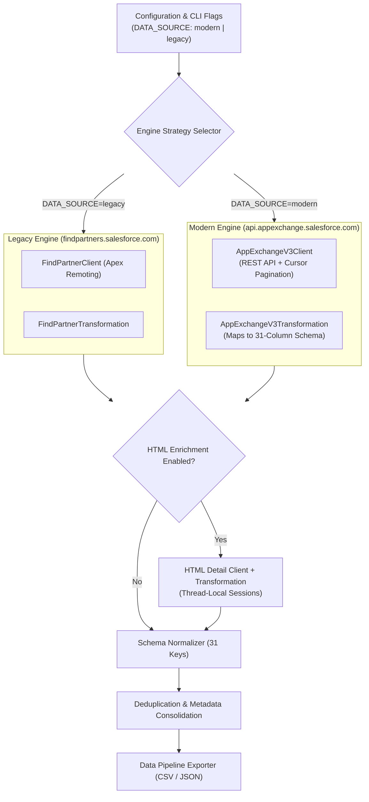

# Implementation Plan: Modern AppExchange v3 Scraper Engine

## 1. Executive Summary & Context

The Salesforce AppExchange ecosystem uses two distinct systems:
1. **Legacy Apex Endpoint** (`findpartners.salesforce.com` via Visualforce remoting):
   - Scope: Primary company registration filter (`Country__c = 'United States of America'`).
   - Yield: ~1,998 records.
2. **Modern AppExchange REST API** (`api.appexchange.salesforce.com/recommendations/v3/listings`):
   - Scope: Live marketplace listings including multi-region and active operational partners.
   - Yield: ~2,150 records.

### Strategy Decision (Confirmed by Pair Programming Alignment)
- **Architecture**: **Dual-Engine / Strategy Pattern**. Keep existing legacy engine intact for backward compatibility; introduce a modern v3 engine selectable via environment variable or CLI flag (`DATA_SOURCE=modern` / `DATA_SOURCE=legacy`).
- **Data Schema**: **31-Column Backward-Compatible Schema**. All modern listings will map directly into the established 31-column schema without breaking downstream CSV/JSON parsers. Any additional modern attributes (e.g. `listing_id`, `tagline`, `is_sponsored`) will be mapped to complementary fields or structured notes.

---

## 2. Technical Architecture & Component Flow

---

## 3. Phase Breakdown & Execution Steps

### Phase 1: Configuration & Filter Settings
- **Files**: `src/config/filters.py`, `.env.example`
- **Tasks**:
  1. Add `DATA_SOURCE` setting (`legacy` vs `modern`, default: `modern` or `legacy`).
  2. Add modern API endpoints and query defaults:
     - Base URL: `https://api.appexchange.salesforce.com/recommendations/v3/listings`
     - Type: `consultants`
     - Location: `US`
     - Default Page Size: `100`

### Phase 2: Modern v3 API Client Implementation
- **File**: `src/clients/appexchange_v3_client.py`
- **Tasks**:
  1. Subclass `BaseClient` to inherit standard retry strategies and header handling.
  2. Implement cursor-based pagination:
     - On page 0: request `recommendations/v3/listings?type=consultants&location=US&pageSize=100&page=0`.
     - Parse `searchQueryUid` from response metadata.
     - On pages 1..N: append `&searchQueryId=<searchQueryUid>` until `totalResults` is satisfied or `listings` is empty.
  3. Include robust error handling and rate-limit backoff.

### Phase 3: Data Transformation & Schema Harmonization
- **File**: `src/transformations/appexchange_v3_transformation.py`
- **Tasks**:
  1. Map the modern JSON response structure to the standardized 31-column partner schema:
     - `title` / `listingName` -> `title`
     - `companyName` -> `company_name`
     - `rating` -> `rating` (preserve 0.0 without falsy string conversion)
     - `reviewCount` -> `reviews_count` (preserve 0 integer)
     - `logoUrl` -> `logo_url`
     - `tagline` / `description` -> `description`
     - `website` / `listingUrl` -> `detail_url` / `website`
  2. Ensure all 31 keys are present with appropriate default values.

### Phase 4: Strategy Dispatcher & Scraper Integration
- **Files**: `src/scrapers/find_partner_scraper.py` (or new orchestrator `src/scrapers/appexchange_scraper.py`), `main.py`
- **Tasks**:
  1. Dynamically select the extraction client and transformation strategy based on `DATA_SOURCE`.
  2. Ensure downstream processing (`HTMLClient`, `MergeTransformation`, `DeduplicateTransformation`, CSV/JSON export) works seamlessly with both data sources.

### Phase 5: Verification & Unit Tests
- **File**: `tests/test_appexchange_v3.py`
- **Tasks**:
  1. Test cursor pagination and `searchQueryId` handling with mocked API responses.
  2. Test transformation logic verifying that all 31 expected columns are accurately populated.
  3. Test zero-value preservation (`rating = 0.0`, `reviews_count = 0`).
  4. Run end-to-end integration dry run to confirm the ~2,150 listing retrieval.

---

## 4. Verification Checklist & Success Criteria

- [ ] All 2,150 consultants are retrievable using the modern v3 API with cursor pagination.
- [ ] Backward compatibility: Running with `DATA_SOURCE=legacy` continues to yield existing behavior without disruption.
- [ ] Strict schema compliance: Output CSV/JSON contains all 31 standardized fields.
- [ ] Zero linting or runtime errors; test suite passing cleanly.

